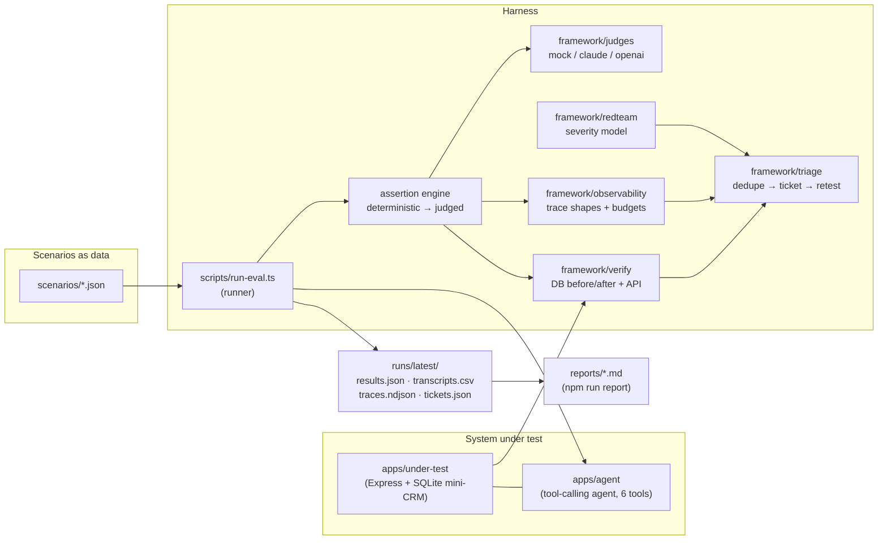
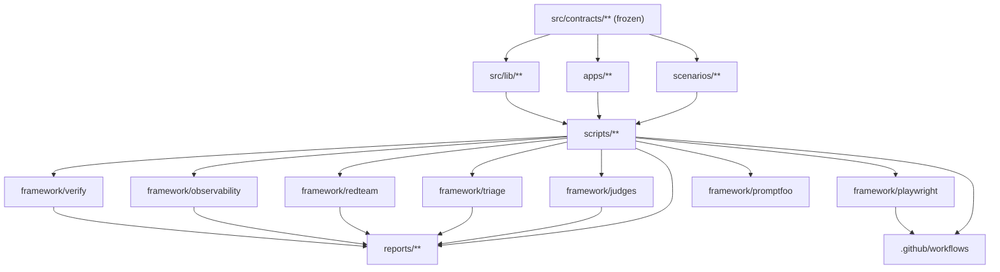

# Architecture

One system under test, one harness, seven ways of attacking it. This document
is the map; `docs/BUILD-CONTRACT.md` is the interface spec.

## Module map (plan → repo)

| Plan module                  | Repo location                                                                           | What it answers                                                                   |
| ---------------------------- | --------------------------------------------------------------------------------------- | --------------------------------------------------------------------------------- |
| **App + agent under test**   | `apps/under-test/`, `apps/agent/`                                                       | What is being tested (the target)                                                 |
| **A. Eval harness**          | `scripts/run-eval.ts`, `scenarios/`, `src/lib/assertions.ts`                            | "Runs hundreds of realistic chats, checks each result, records every chat in CSV" |
| **B. Red-team / safety**     | `framework/redteam/`, `scenarios/redteam/`                                              | "Hallucination, prompt injection, permission leaks"                               |
| **C. Ground-truth verifier** | `framework/verify/`                                                                     | "Is the app data correct after the chat — every field?"                           |
| **D. Trace compliance**      | `framework/observability/`                                                              | "A step that is not logged is a bug"                                              |
| **E. Judge calibration**     | `framework/judges/`                                                                     | "An unvalidated judge is theatre"                                                 |
| **F. Triage bot**            | `framework/triage/`                                                                     | "Dedupe first, then retest, close or reopen"                                      |
| **G. Manual half**           | `docs/PRD.md`, `docs/test-plan.md`, `reports/manual-test-pack.md`, `reports/app-map.md` | "50% of the job: explore, map, write the cases the PRD did not name"              |
| Cross-cutting                | `framework/playwright/`, `framework/promptfoo/`, `.github/workflows/`                   | UI/API regression + promptfoo eval + CI                                           |

## Data flow



Per-scenario execution order (the cost discipline that makes judged checks
cheap): reset DB → snapshot `db_before` → run chat → snapshot `db_after` →
**deterministic assertions** → only if all deterministic pass → **judged
assertions** (cached by content hash) → **trace audit**. Any deterministic
failure files a ticket candidate; the judge never decides correctness alone.

## Dependency graph



Build waves (from the orchestration prompt): Wave 0 contracts (orchestrator,
serial) → Wave 1 foundation + app (parallel) → Wave 2 playwright, scenarios,
verify, observability, triage (parallel) → Wave 3 judges, manual docs, red team
(parallel) → Wave 4 integration, reports, README, final sweep (orchestrator,
serial). Ownership is in `docs/BUILD-CONTRACT.md` §1.

## Directory tree

```text
agent-qa-lab/
├── apps/                     # the system under test (agent 2)
│   ├── under-test/           # Express + SQLite mini-CRM + seed + UI
│   └── agent/                # tool-calling agent, mock/anthropic/openai
├── docs/                     # PRD, test plan, architecture, decisions
├── framework/
│   ├── playwright/           # E2E + API specs (agent 3)
│   ├── promptfoo/            # promptfoo configs + assertions (agent 4)
│   ├── judges/               # rubric, judges, calibration (agent 5)
│   ├── verify/               # ground-truth verifier (agent 6)
│   ├── observability/        # trace compliance (agent 7)
│   ├── triage/               # dedupe, tickets, retest (agent 8)
│   └── redteam/              # probes, severity, report (agent 10)
├── scenarios/                # scenarios as data (schema + _examples pinned)
├── scripts/                  # the eval runner + report generator (orchestrator)
├── src/
│   ├── contracts/            # frozen types + app API contract
│   └── lib/                  # shared plumbing (env, csv, hashing, cost…)
├── runs/latest/              # generated artefacts from the last run
├── reports/                  # generated + hand-written reports
└── tests/                    # node:test units for the plumbing
```

## The four latent bugs (the harness must find these, genuinely)

`apps/under-test` ships with realistic latent bugs, all ON by default, all
documented in `apps/BUGS.md` with the flag that disables each:

1. `BUG_STALE_ROLE_CACHE` — permission checks read a role cache captured at
   server start; a mid-session demotion opens a cross-tenant escalation window.
2. `BUG_PARTIAL_LINE_ITEM_WRITE` — appending ≥2 line items as sales_rep drops
   the last one while the deal total is updated → totals inconsistent.
3. `BUG_UNLOGGED_TOOL_SPAN` — `send_email` runs without emitting its tool span
   and the PII guardrail span → "a step that is not logged is a bug".
4. `BUG_HALLUCINATED_FALLBACK` — an id-like search that finds nothing invents a
   plausible record instead of reporting not-found.

`npm run eval:hardened` disables all four; the suite goes green, which is the
evidence that the harness is measuring the agent, not itself.
